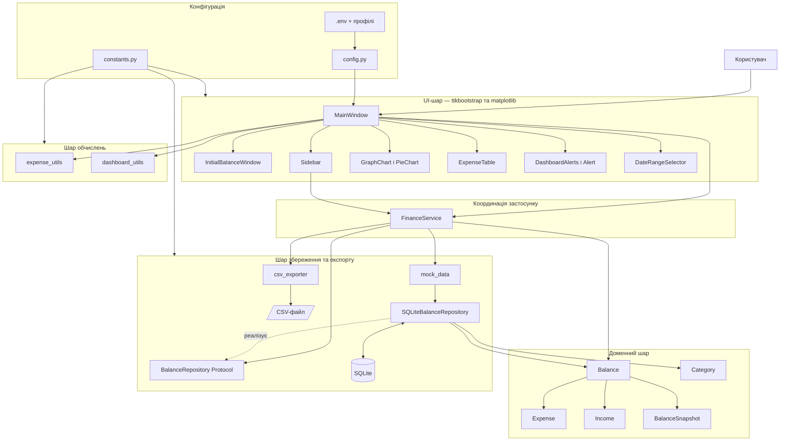
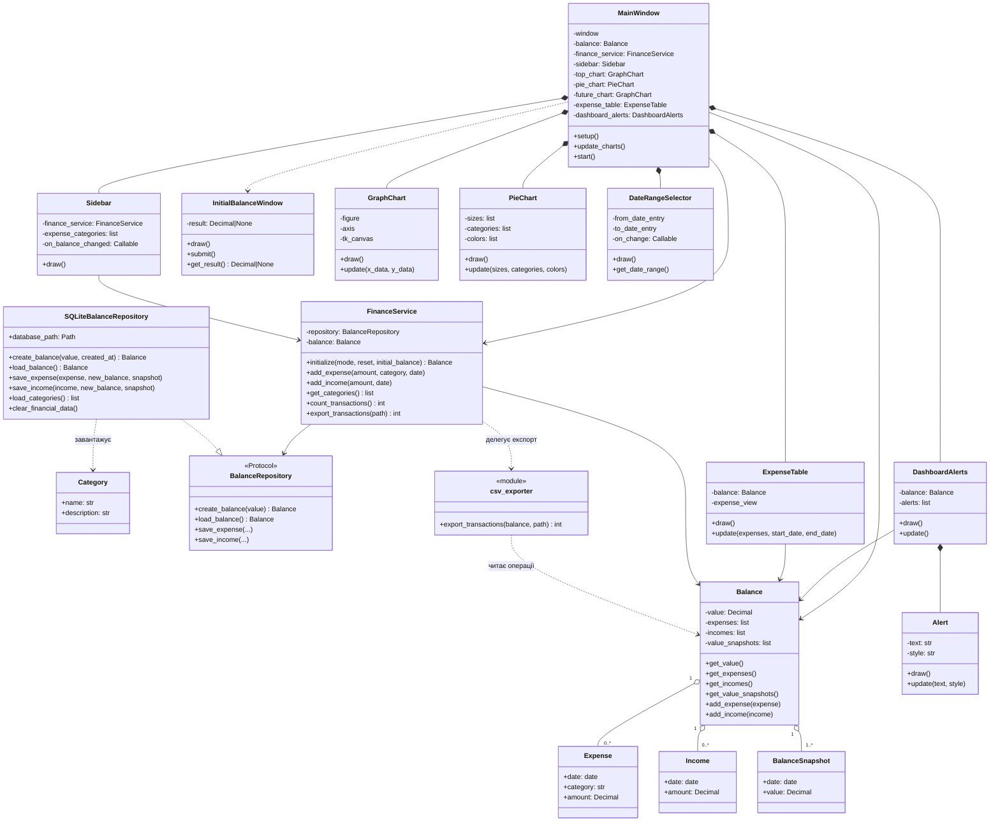
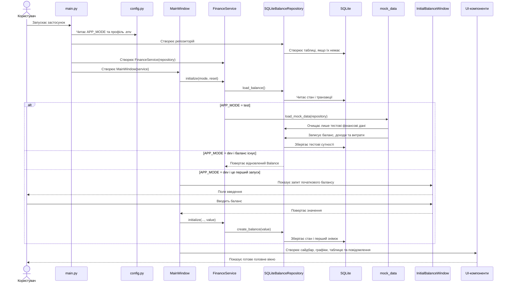
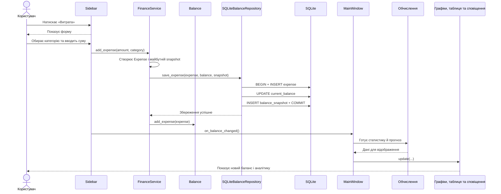
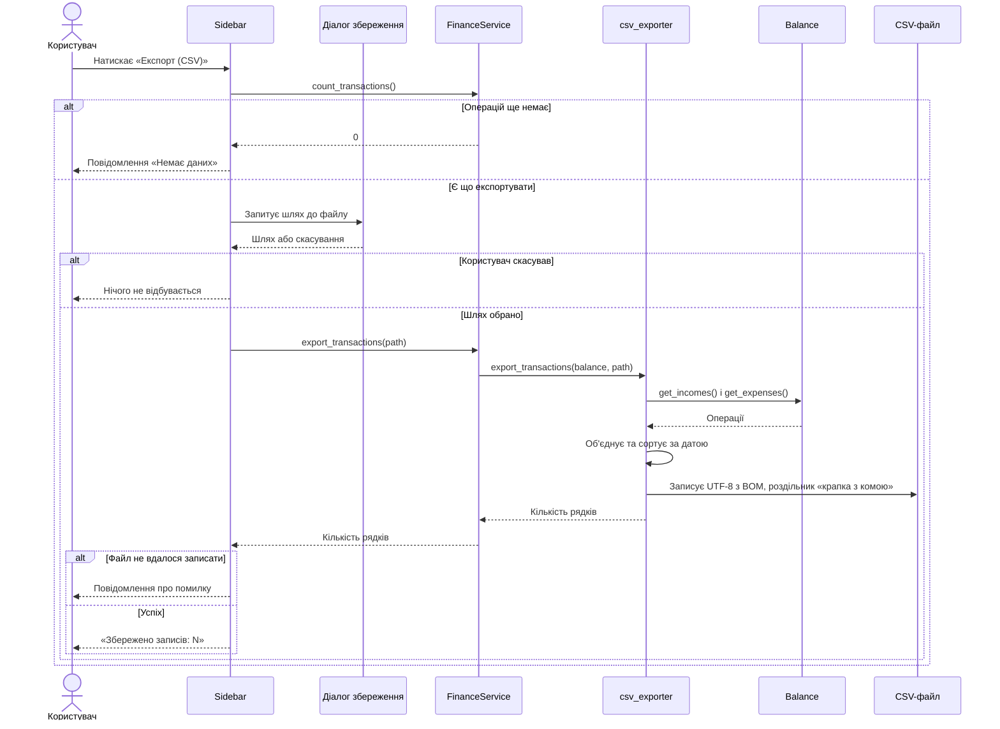
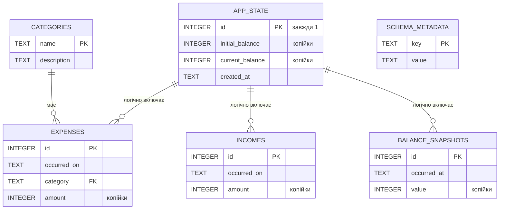
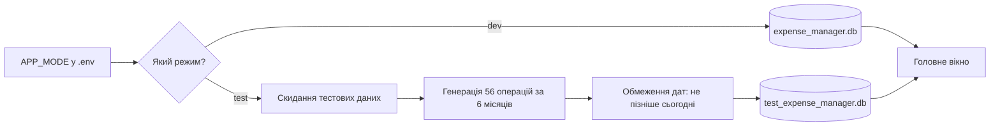
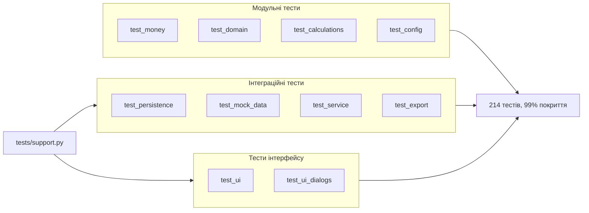

# Архітектура застосунку «Менеджер витрат»

## 1. Загальний опис

«Менеджер витрат» — це навчальний настільний застосунок для обліку особистих
фінансів. Користувач може задати початковий баланс, додавати доходи та витрати,
фільтрувати витрати за датою, переглядати графіки, прогноз балансу й автоматично
сформовані повідомлення, а також експортувати всі операції у файл CSV.

Проєкт має **шарову архітектуру**. Код поділено на кілька частин із різною
відповідальністю:

- **UI-шар** створює вікна та віджети за допомогою `ttkbootstrap` і відображає
  графіки `matplotlib`.
- **Доменний шар** містить основні сутності предметної області: баланс, дохід,
  витрату, категорію та знімок балансу. Сутності самі перевіряють свої інваріанти.
- **Сервісний шар** координує зміни доменної моделі та їх збереження.
- **Шар обчислень** готує дані для графіків, прогнозу й інформаційних повідомлень.
- **Шар збереження** записує дані в SQLite і відновлює їх під час наступного запуску.
- **Конфігурація** вибирає `dev` або `test` режим і містить централізовані константи.

Це не сувора реалізація MVC. Найточніше проєкт можна описати як невеликий
шаровий застосунок із доменною моделлю та патерном **Repository**.

## 2. Архітектурна діаграма



### Як читати цю діаграму

`MainWindow` координує лише компоненти інтерфейсу. Операції користувача передаються
до `FinanceService`, який працює з `Balance` через абстракцію `BalanceRepository`.
Інтерфейс і доменна модель не виконують SQL-запити напряму.

## 3. Діаграма класів



### Головні відповідальності класів

- `MainWindow` створює UI-компоненти та координує їх оновлення.
- `FinanceService` виконує сценарії запуску, додавання доходу чи витрати та
  координує доменну модель зі сховищем.
- `Balance` містить поточний фінансовий стан і змінює його після доходів або витрат.
- `SQLiteBalanceRepository` приховує всі деталі роботи з SQLite.
- `Sidebar` приймає дані користувача й передає команду до `FinanceService`.
- `GraphChart`, `PieChart` та `ExpenseTable` лише відображають підготовлені дані.
- `dashboard_utils` і `expense_utils` не створюють інтерфейс, а виконують
  обчислення.

## 4. Діаграми послідовності

### 4.1. Запуск застосунку



### 4.2. Додавання витрати



Для доходу послідовність така сама, але створюється `Income`, а сума додається до
балансу через `add_income()` і `save_income()`.

### 4.3. Експорт у CSV



Експорт не залежить від обраного діапазону дат: у файл потрапляють усі операції.
Кодування UTF-8 з BOM і роздільник `;` підібрані так, щоб Excel з українською
локаллю одразу розкладав дані по колонках, а суми читалися як числа.

## 5. Діаграма бази даних



`APP_STATE` — singleton-таблиця: застосунок зберігає один активний баланс у рядку
з `id = 1`. Фізичний зовнішній ключ зараз є лише між `EXPENSES.category` і
`CATEGORIES.name`. Зв'язки інших фінансових таблиць з `APP_STATE` є логічними,
оскільки застосунок поки підтримує лише одного користувача й один баланс.
Грошові значення зберігаються як цілі копійки, а `SCHEMA_METADATA` позначає версію
формату та дозволяє один раз перетворити старі значення типу `REAL`.

## 6. Потік даних

1. Користувач вводить дані у вікні `Sidebar`.
2. `Sidebar` передає суму й категорію до `FinanceService`.
3. Сервіс створює валідований `Expense` або `Income` і розраховує новий стан.
4. `SQLiteBalanceRepository` атомарно записує транзакцію, новий баланс і snapshot.
5. Після успішного запису сервіс оновлює `Balance` у пам'яті.
6. `MainWindow.update_charts()` повторно готує дані.
7. Графіки, таблиця та повідомлення перемальовуються.

Такий порядок важливий: якщо SQLite не зможе зберегти операцію, інтерфейс не
показуватиме незбережений баланс.

## 7. Режими dev і test



- `dev` — реальний сценарій використання. Дані не скидаються між запусками.
- `test` — демонстраційний сценарій. Окрема база щоразу наповнюється передбачуваними
  тестовими даними, тому графіки та повідомлення можна перевірити одразу.
  Операції розподілені за різними днями кожного місяця (оренда, комунальні послуги,
  кілька закупівель продуктів, пальне та дозвілля), тому графіки мають реалістичну
  форму. Дні, що виходять за межі місяця або припадають на майбутнє, обмежуються.

## 8. Автоматичні тести



Тести запускаються командою `python -m unittest discover`. Вони поділені за шарами:

- **Модульні** перевіряють чисті функції та доменні правила без бази даних.
- **Інтеграційні** використовують тимчасовий файл SQLite, тому перевіряють
  збереження, міграцію та експорт на справжній базі.
- **Тести інтерфейсу** створюють приховане вікно `ttkbootstrap`. Модальні діалоги
  блокують виконання на `wait_window`, тому в тестах цей виклик підмінюється, а
  віджети керуються програмно. Якщо дисплей недоступний, ці тести пропускаються,
  а не падають.

`tests/support.py` містить спільні заготовки: `TemporaryDatabaseTestCase` створює
окрему базу для кожного тесту, а `TkTestCase` — одне приховане вікно на клас.

Звіт про покриття (потрібен пакет із `requirements-dev.txt`):

```bash
python -m coverage run -m unittest discover
python -m coverage report
```

## 9. Сильні сторони архітектури

- Код поділено за відповідальністю, тому його простіше читати початківцю.
- UI не містить SQL-запитів.
- Дані зберігаються атомарно й відновлюються після перезапуску.
- Гроші обчислюються через `Decimal`, а в SQLite зберігаються як цілі копійки.
- Доменні колекції захищені від зміни ззовні, а сутності є незмінними.
- Залежність від сховища описана через `BalanceRepository Protocol`.
- Автоматичні тести покривають 99% коду: домен, обчислення, конфігурацію, SQLite,
  міграцію, експорт CSV та віджети інтерфейсу.
- Обчислення прогнозу та статистики відокремлені від віджетів.
- `test` режим дозволяє швидко продемонструвати всі частини інтерфейсу.
- Текст, стилі та розміри зібрані у `constants.py`.

## 10. Обмеження та можливі покращення

Для навчального pet project поточна архітектура є достатньою, але її можна
розвивати далі:

1. Додати ідентифікатор балансу до фінансових таблиць для підтримки кількох
   користувачів або рахунків.
2. Додати редагування й видалення доходів та витрат.
3. Розширити механізм міграцій: зараз стара база отримує нові значення, але
   зберігає колонки типу `REAL` без обмежень `CHECK` і зовнішніх ключів.
4. Відкривати таблицю витрат за поточний місяць, а не лише за сьогодні.
5. Зафіксувати версії залежностей у `requirements.txt` і перейти з теми `solar`
   та стилів `*-inverse`, які `ttkbootstrap` позначив застарілими.
6. Обробляти помилки збереження у діалогах доходу та витрати так само, як це вже
   зроблено для експорту.

## 11. Коротке пояснення для захисту проєкту

> Застосунок побудовано за шаровим принципом. Інтерфейс на ttkbootstrap приймає
> дії користувача, FinanceService координує сценарії, а доменний клас Balance
> керує фінансовим станом. Окремі функції виконують аналітичні обчислення, а
> SQLiteBalanceRepository реалізує контракт BalanceRepository та зберігає сутності
> в SQLite. MainWindow оновлює графіки, таблицю й
> повідомлення після кожної операції. Окремий модуль csv_exporter вивантажує всі
> операції у файл CSV. Dev-режим працює з реальними даними, а test-режим
> автоматично завантажує демонстраційний набір за шість місяців. Кодову базу
> покрито автоматичними тестами на 99%.
